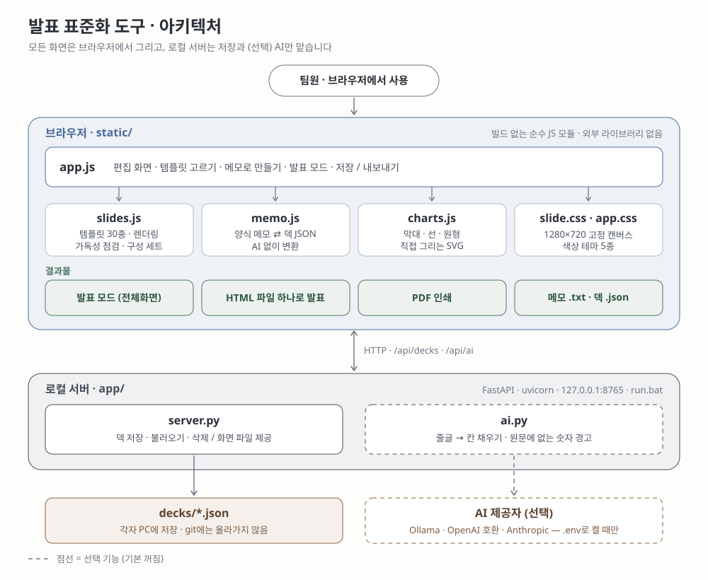

# 아키텍처와 선택 이유



## 이 도구가 풀려는 문제

- 팀원 5명이 멘토링 때마다 각자 다른 방식으로 발표해서 알아듣기 어렵다.
- 슬라이드가 줄글 위주라 시각 자료가 부족하다.
- 멘토님은 PPT가 아니라 HTML/웹으로 된 발표를 원하신다.

그래서 목표를 이렇게 잡았습니다.

1. **양식을 강제한다.** 정해진 템플릿을 골라 칸만 채우면 되게 한다.
2. **줄글을 막는다.** 글자 수를 제한하고 시각 자료를 쓰도록 유도한다.
3. **결과물은 웹이다.** 브라우저에서 발표하고, HTML 파일로 넘길 수 있게 한다.
4. **누구 PC에서나 바로 돈다.** 설치를 최소로 하고, 인터넷이나 유료 API가 없어도 동작해야 한다.

아래 결정들은 모두 이 네 가지에서 나왔습니다.

---

## 1. 웹 슬라이드 (PPT 아님)

| 선택 | 이유 |
|---|---|
| 슬라이드를 HTML + CSS로 그림 | 멘토님이 웹 발표를 원하심. 브라우저만 있으면 어디서든 열림 |
| 1280×720 고정 캔버스를 크기만 바꿔서 표시 | 미리보기, 썸네일, 발표, HTML 파일, PDF가 **모두 같은 모양**으로 나옴. 화면 크기에 따라 글자 위치가 바뀌는 문제가 없음 |
| 차트를 직접 SVG로 그림 | 차트 라이브러리 없이 파일 하나에 다 들어감. 확대해도 깨지지 않음 |

**포기한 것:** PPT처럼 글상자를 마음대로 옮기는 자유 배치. 대신 이게 "양식 통일"이라는 목적에 맞습니다. 사람마다 배치를 바꿀 수 있으면 다시 제각각이 되기 때문입니다.

## 2. 템플릿 = 칸 정의(fields) + 그리는 함수(render)

```js
{ id, name, category, fields: [...], sample: {...}, render: (v) => `<html>` }
```

| 선택 | 이유 |
|---|---|
| 템플릿마다 칸 이름, 종류, 글자 수 제한, 예시를 데이터로 정의 | 편집 폼, 가독성 점검, 메모 변환, AI 프롬프트가 **모두 이 정의를 읽어서 자동으로 만들어짐** |
| 칸마다 글자 수와 항목 수 제한 | 줄글 방지. 넘으면 빨갛게 표시하고 경고를 띄움 |
| 빈 슬라이드에 예시를 흐리게 표시 | 무엇을 써야 할지 바로 보임 |

**효과:** 템플릿을 하나 추가할 때 `slides.js`에 객체 하나와 CSS만 넣으면 됩니다. 폼, 점검, 메모 문법을 따로 만들 필요가 없습니다.

## 3. 덱 = JSON 한 덩어리

```json
{ "meta": { "title", "presenter", "date", "session", "theme" },
  "slides": [ { "type", "values", "notes" } ] }
```

| 선택 | 이유 |
|---|---|
| 내용(values)만 저장하고 모양은 저장하지 않음 | 테마나 템플릿 디자인을 고치면 **예전 덱에도 바로 반영**됨 (색상 톤을 낮췄을 때 실제로 그랬음) |
| 사람이 읽을 수 있는 JSON | 팀원끼리 파일로 주고받거나 git에 올리기 쉬움 |

## 4. 빌드 없는 순수 JavaScript

| 선택 | 이유 |
|---|---|
| React, Vite 같은 빌드 도구를 쓰지 않음 | 팀원 PC에 Node가 없어도 됨. 설치가 `uv sync` 하나로 끝남 |
| ES 모듈 파일 몇 개로 나눔 (`app`, `slides`, `memo`, `charts`, `util`) | 화면, 템플릿, 변환, 차트가 서로 섞이지 않음 |
| 외부 라이브러리 없음 (글꼴만 CDN) | 내보낸 HTML 파일 하나로 발표가 됨. 버전 충돌도 없음 |

**포기한 것:** 컴포넌트 단위 상태 관리 같은 React의 편의 기능. 이 도구는 화면이 하나이고 상태도 "덱 하나 + 현재 슬라이드 번호"뿐이라 없어도 충분하다고 판단했습니다.

## 5. 로컬 서버 (FastAPI)

| 선택 | 이유 |
|---|---|
| 각자 PC에서 `127.0.0.1`로 실행 | 클라우드 배포나 계정 관리가 필요 없음. 발표 내용이 밖으로 나가지 않음 |
| 서버는 **저장·불러오기와 (선택) AI만** 담당 | 화면 그리기와 메모 변환은 전부 브라우저가 함. 서버가 꺼져도 내보낸 HTML은 열림 |
| Python + uv | 팀 프로젝트와 같은 언어라 누구나 고칠 수 있음. uv로 버전을 고정해서 PC마다 환경이 달라지지 않음 |
| 덱은 `decks/` 폴더에 JSON 파일로 저장 (DB 없음) | 설치할 것이 없고, 파일을 그대로 복사하거나 백업할 수 있음 |

## 6. 메모로 만들기 (AI 없이)

처음에는 "줄글을 붙여넣으면 AI가 슬라이드로 정리"하는 방식을 기본으로 생각했습니다. 로컬 모델로 시험해 보니 문제가 있었습니다.

- GPU 없는 노트북(CPU만)에서 슬라이드 **한 장에 40~180초**가 걸렸고, 덱 전체 초안은 **5분을 넘겨 실패**했습니다.
- 작은 모델은 원문에 없는 숫자나 내용을 **지어내는** 경우가 있었습니다.

그래서 기본 입력 방식을 **정해진 양식의 메모**로 바꿨습니다.

```
# KPI: 이번 주 지표
- 정답률 | 86 | % | +15%p | 좋아짐
```

| 선택 | 이유 |
|---|---|
| `# 종류: 제목`, `칸: 값`, `- a \| b` 세 가지 문법 | 배우기 쉽고, 메모장에 쓰던 습관 그대로 쓸 수 있음 |
| 브라우저 안에서 즉시 변환 | 기다리는 시간이 0이고, **쓴 내용 외에는 아무것도 들어가지 않음** |
| 덱 → 메모 역변환 지원 | 화면에서 만든 덱을 글로 고치거나 .txt로 보관 가능 |
| 줄임말 허용 (`KPI`, `차트`, `회고`, `코드` 등) | 정확한 템플릿 이름을 외우지 않아도 됨 |

## 7. AI는 선택 기능 (기본 꺼짐)

| 선택 | 이유 |
|---|---|
| `.env`에서 켤 때만 동작, 꺼져 있으면 버튼도 숨김 | 쓰지 않는 사람에게 혼란을 주지 않음 |
| 로컬 모델과 외부 API 둘 다 연결 가능 (OpenAI 호환 / Anthropic) | GPU가 있는 PC나 API 키가 있는 사람만 골라서 쓸 수 있음 |
| 원문에 없는 숫자가 나오면 경고 | 지어낸 숫자가 발표에 들어가는 것을 막음 |
| 빈 칸 틀(JSON)을 주고 채우게 함 | 모델이 칸 이름을 바꾸거나 형식을 깨는 것을 줄임 |

## 8. 공유 방식

| 대상 | 방법 |
|---|---|
| 도구 자체 | GitHub 저장소. 팀원은 `git clone` → `uv sync` → `run.bat` |
| 발표 자료 (멘토님께) | **HTML 파일로 내보내기**. 파일 하나만 보내면 됨 |
| 덱 원본 (팀원끼리) | `.json` 내보내기/가져오기 또는 메모 `.txt` |
| 개인 설정 (`.env`), 작업 중인 덱 (`decks/`) | git에 올리지 않음 |

---

## 한계와 나중에 할 수 있는 것

- **동시 편집 없음:** 덱은 각자 PC에 저장됩니다. 한 덱을 여럿이 같이 고치려면 JSON이나 메모 파일을 주고받아야 합니다.
- **자유 배치 없음:** 템플릿에 없는 레이아웃이 필요하면 템플릿을 새로 추가해야 합니다. 이건 의도한 제약입니다.
- **글꼴만 온라인:** 오프라인이면 맑은 고딕으로 보입니다. 필요하면 글꼴 파일을 함께 넣을 수 있습니다.
- **실행 파일 없음:** 지금은 uv가 필요합니다. 필요하면 PyInstaller로 `.exe`를 만들 수 있습니다.
